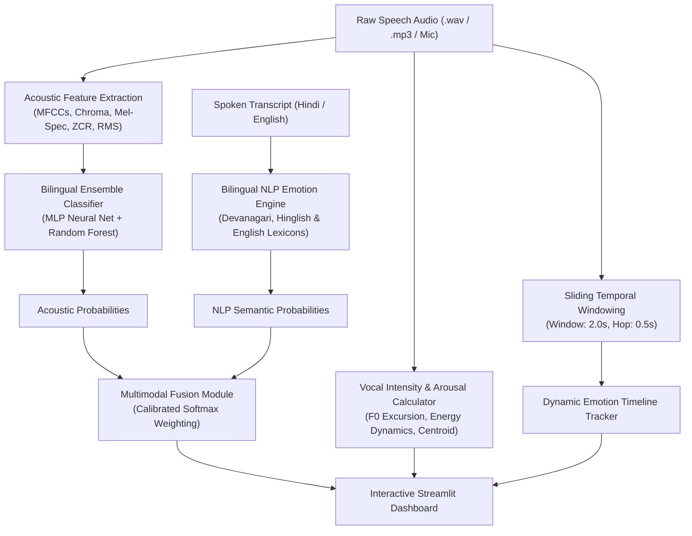

# 🎙️ Bilingual Speech Emotion Recognition (SER) System
### Multimodal Acoustic Prosody & NLP Emotion Intelligence | 🇮🇳 Hindi & 🇬🇧 English

[](https://www.python.org/)
[](https://streamlit.io/)
[](https://scikit-learn.org/)
[](https://librosa.org/)
[](https://plotly.com/)
[](LICENSE)

An enterprise-grade, end-to-end **Speech Emotion Recognition (SER)** and **Multimodal Emotion Intelligence** system developed in Python. The system processes raw vocal acoustics and transcript semantics to classify emotions, measure vocal intensity, compute calibrated confidence scores, trace emotion timelines across time, and present interactive analytics via a Streamlit web application.

---

## 🌟 Key Features

- 🇮🇳 **Bilingual Acoustic & NLP Modeling (Hindi & English)**:
  - Supports acoustic intonations, pitch accentuation, and vocal dynamics of both English and Hindi speech.
  - Features a built-in Hindi affective lexicon (Devanagari script + Romanized Hinglish) and English affective lexicon with negation and exclamation handling.
- ⚡ **Emotion Intensity Quantification (0 - 100%)**:
  - Computes vocal effort and arousal from RMS energy, fundamental frequency variability ($F_0$ excursion), spectral centroid brightness, and dynamic range.
  - Categorizes vocal delivery into bilingual tiers: **Subtle (हल्का)**, **Moderate (मध्यम)**, **High (तीव्र)**, and **Intense (अत्यधिक तीव्र)**.
- 🎯 **Calibrated Confidence Scoring**:
  - High-capacity ensemble architecture combining a **Deep Multi-Layer Perceptron (MLP)** Neural Network and a **Random Forest Classifier** with soft probability voting.
  - Predicts confidence percentages across 7 core emotions: **Angry, Disgust, Fear, Happy, Neutral, Sad, Surprise**.
- 📈 **Dynamic Emotion Timeline (Sliding Acoustic Windows)**:
  - Divides speech into overlapping temporal segments (e.g., 2.0s windows with 0.5s hop) to visualize how emotion probabilities and vocal intensity fluctuate over time.
- 💬 **Multimodal NLP & Acoustic Fusion**:
  - Blends acoustic prosody predictions with spoken transcript semantic analysis (configurable weighting, e.g. 70% Audio + 30% Text).
  - Detects **Modal Congruence** (whether spoken tone and semantic words agree or contrast, highlighting sarcasm or masked feelings).
- 🖥️ **Interactive Web Dashboard**:
  - **Live Microphone Recording**: Record voice directly inside the browser.
  - **Audio File Upload**: Process `.wav`, `.mp3`, `.ogg`, or `.flac` files.
  - **14 Preloaded Bilingual Emotion Samples**: Test all 7 emotions in Hindi and English with one click!
  - **Interactive Plotly Visualizations**: Confidence bar charts, 7-axis radar emotional footprints, and time-series line graphs.

---

## 🏗️ System Architecture



---

## 📊 Core Emotions Supported

| Emotion | Emoji | Hindi Equivalent | Acoustic & Prosodic Signatures |
| :--- | :---: | :--- | :--- |
| **Angry** | 😡 | गुस्सा / क्रोध | High $F_0$ pitch peaks, rapid acoustic attack, high energy bursts |
| **Happy** | 😊 | खुशी / आनंद | Dynamic melodic pitch contour, lively rhythm, spectral brightness |
| **Sad** | 😢 | उदासी / गम | Falling pitch slope, depressed RMS energy, subdued spectral tilt |
| **Fear** | 😨 | डर / भय | Rapid frequency jitter, elevated mean pitch, breathy vocalics |
| **Neutral** | 😐 | शांत / सामान्य | Monotone pitch contour, balanced energy, steady speech rate |
| **Surprise** | 😲 | आश्चर्य / हैरान | Sharp upward pitch spike, sudden spectral energy onset |
| **Disgust** | 🤢 | घृणा / चिढ़ | Low pitch variability, guttural subharmonics, elongated vowels |

---

## 🚀 Quick Start Guide

### 1. Prerequisites
- Python 3.10, 3.11, 3.12, or 3.13
- Git

### 2. Clone and Setup Environment
```bash
# Clone the repository
git clone https://github.com/<your-username>/speech-emotion-recognition.git
cd speech-emotion-recognition

# Create and activate virtual environment
python -m venv venv

# Windows
venv\Scripts\activate

# macOS / Linux
source venv/bin/activate

# Install dependencies
pip install -r requirements.txt
```

### 3. Launch the Interactive Dashboard or JupyterLab

#### To open the Streamlit Web Dashboard:
```bash
streamlit run app.py
```
Open your browser at `http://localhost:8501`.

#### To run the JupyterLab Interactive Notebook:
```bash
jupyter lab notebook_demo.ipynb
```
Or double-click `run_jupyter.bat` on Windows.

---

## 💻 CLI Commands

### Train the Bilingual Model
```bash
# Train using the bilingual generator (40 samples per emotion)
python train.py --samples 40

# Train with an external dataset directory (e.g. RAVDESS or custom WAV folder)
python train.py --dataset_dir path/to/dataset
```

### Evaluate Model & Test Audio Files
```bash
# View model accuracy, confusion matrix, and classification report
python evaluate.py

# Test an individual audio file
python evaluate.py --audio data/sample_audios/hindi/khushi_happy_sample.wav --transcript "आज मैं बहुत खुश हूँ!"
```

---

## 📁 Repository Directory Structure

```text
speech-emotion-recognition/
├── .gitignore                      # Git ignore rules
├── README.md                       # Comprehensive project documentation
├── requirements.txt                # Python package dependencies
├── app.py                          # Streamlit Interactive Dashboard
├── train.py                        # Standalone training script
├── evaluate.py                     # Evaluation and metrics viewer
├── setup_git.py                    # Automated GitHub staging and push script
├── setup_github.bat                # Windows 1-click batch launcher for GitHub
├── data/
│   └── sample_audios/              # 14 Preset demo audio files
│       ├── english/                # English samples (7 emotions)
│       └── hindi/                  # Hindi samples (7 emotions)
├── saved_models/
│   ├── ser_bilingual_model.joblib  # Trained Ensemble Model (MLP + Random Forest)
│   ├── ser_scaler.joblib           # StandardScaler for 237-dim features
│   └── ser_metadata.json           # Model metrics & confusion matrix
└── src/
    ├── config.py                   # Global system constants & hyper-parameters
    ├── features/
    │   ├── audio_features.py       # 237-dim feature extraction & temporal windows
    │   └── intensity_calculator.py # Acoustic vocal arousal & intensity metric
    ├── nlp/
    │   ├── nlp_emotion.py          # Bilingual NLP sentiment & emotion analyzer
    │   └── multimodal_fusion.py    # Cross-modal acoustic + semantic fusion
    ├── models/
    │   ├── model_trainer.py        # Model training & dataset synthesis engine
    │   └── ser_pipeline.py         # End-to-end inference pipeline
    └── utils/
        ├── audio_generator.py      # Speech formant & prosody synthesizer
        └── visualizer.py           # Plotly interactive charts & indicators
```

---

## 🐙 Push to Your GitHub Account

You can upload this entire project to your GitHub in one simple step:

### Option A: Using the Automated Python Script
1. Create a new repository on [GitHub](https://github.com/new) (e.g., `speech-emotion-recognition`).
2. Run:
```bash
python setup_git.py --repo https://github.com/<your-username>/speech-emotion-recognition.git
```

### Option B: Using Windows 1-Click Batch File
Double-click `setup_github.bat` and paste your repository URL when prompted.

### Option C: Standard Git Commands
```bash
git add .
git commit -m "feat: Bilingual Speech Emotion Recognition System (Hindi & English)"
git branch -M main
git remote add origin https://github.com/<your-username>/speech-emotion-recognition.git
git push -u origin main
```

---

## 📜 License
This project is licensed under the MIT License - see the [LICENSE](LICENSE) file for details.
